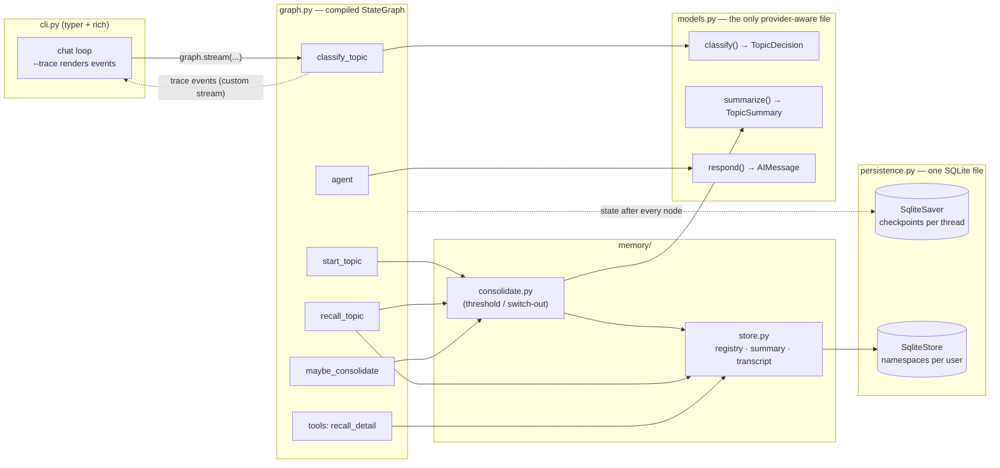
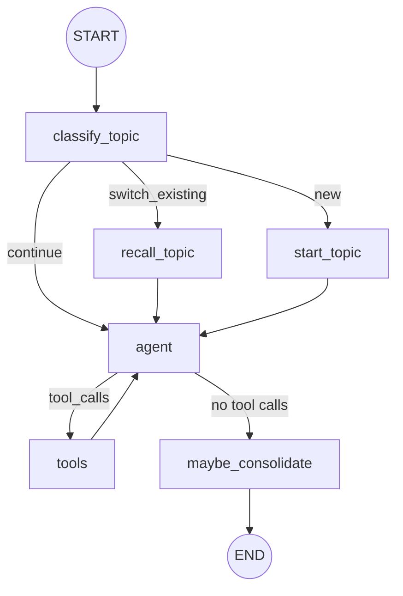
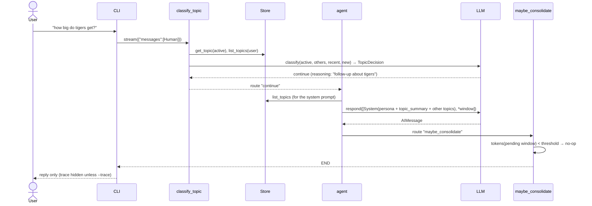
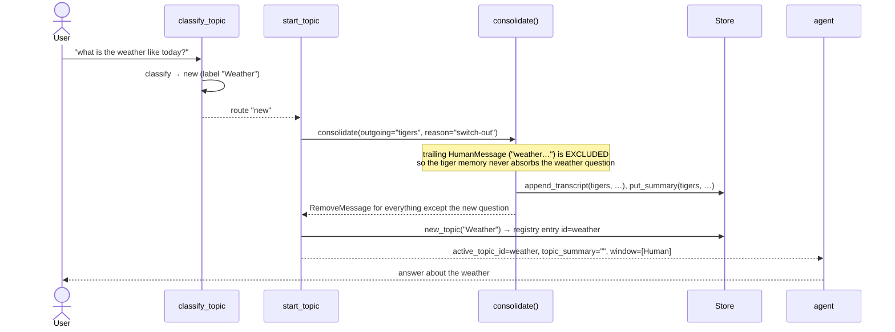
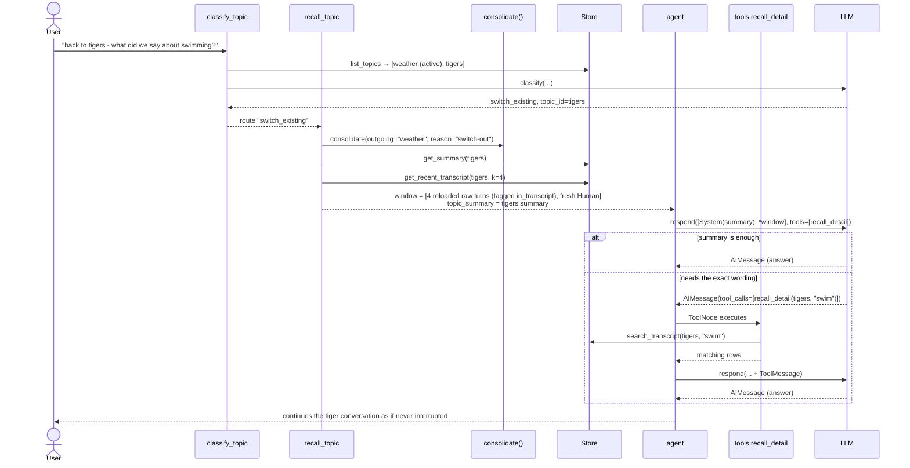

# Topic-aware memory for a LangGraph agent — architecture

This document explains, from the ground up, how the harness in `src/harness/`
gives a chat agent long-term memory that is organised by *topic*: the agent
periodically folds the conversation into memory, notices when the user
changes subject, and silently brings an old subject back when the user
returns to it. Every section pairs a concept with a diagram, the real code,
and something to try at the CLI.

The code is a proof of concept for learning. It favours visible mechanisms
over clever abstractions, which is also why it hand-builds a `StateGraph`
instead of using LangChain's `create_agent` + `SummarizationMiddleware`
(covered at the end as the production shortcut).

---

## 1. Overview

### The problem

A single chat session can run for hours and wander across subjects: tigers,
then the weather, then back to tigers. Two things go wrong if you simply keep
appending messages:

1. **The context window fills up.** Every turn re-sends the whole history, so
   cost and latency grow until the model's limit is hit.
2. **Old subjects drown.** Even inside the limit, a question about tigers
   after forty turns about the weather gets answered badly because the tiger
   details are buried.

The naive fix, "summarise everything when it gets long", solves 1 but makes 2
worse: one blended summary of tigers-and-weather loses the detail of both.

### The idea: memory per topic, in three tiers

| Tier | What it holds | Where it lives | Lifetime |
|---|---|---|---|
| **Working window** | The raw messages the model sees on this turn | LangGraph *state*, checkpointed per thread | Trimmed continuously |
| **Topic summary** | A structured, incrementally updated digest of one topic (facts, preferences, open questions, entities, narrative) | LangGraph *store*, per user | Forever |
| **Raw transcript** | Every message ever consolidated, in order, per topic | LangGraph *store*, per user | Forever |

The agent always works from a small window plus the summary of the topic the
user is currently on. When the user switches, the outgoing topic is
consolidated (summary + transcript) and the window is swapped for the
incoming topic's summary plus its last few raw turns. The user never sees
any of this; the `--trace` flag exists so *you* can.

### Requirements → mechanisms

| Requirement | Mechanism | Code |
|---|---|---|
| 1. Periodically save the conversation to memory, per topic | Token-threshold consolidation after every reply, plus forced consolidation whenever the topic changes | `nodes/agent.py: maybe_consolidate`, `memory/consolidate.py` |
| 2. Find the topic again when the user comes back to it | An LLM classifier that sees the registry of known topics and returns `continue` / `switch_existing` / `new` with reasoning | `nodes/classify.py`, `models.py: CLASSIFY_SYSTEM` |
| 3. Offload the topic from context but recall it easily | `RemoveMessage` shrinks the window; recall reloads summary + last K raw turns; a `recall_detail` tool lets the agent search the raw transcript | `nodes/topics.py`, `nodes/agent.py: make_recall_tool` |
| Keep the full history, not just a summary | Raw messages are appended to the store *before* they are removed from state | `memory/store.py: append_transcript` |
| Invisible to the user, visible to you | Trace events on LangGraph's custom stream; the CLI prints them only with `--trace` | `tracing.py`, `cli.py` |

### Glossary (LangGraph terms used throughout)

- **State** — the dict a graph carries between nodes. Ours is `MemoryState`.
- **Node** — a Python function `(state, config) -> partial state update`.
- **Reducer** — how an update merges into state. `messages` uses `add_messages`, which appends, replaces by id, and honours `RemoveMessage`.
- **Checkpointer** — persists state after every step, keyed by `thread_id`. Lets a conversation resume. We use `SqliteSaver`.
- **Store** — a separate key/value tree with tuple namespaces, independent of any thread. We use `SqliteStore`. Memory lives here.
- **Thread** — one conversation (`--session` in the CLI). **User** — the owner of the memory (`--user`). Many threads, one user.

---

## 2. Component architecture



Reading the diagram:

- The **CLI** only ever calls `graph.stream(...)` and renders two kinds of
  stream chunks: node *updates* and *custom* trace events.
- The **graph** has six nodes. Three of them (`start_topic`, `recall_topic`,
  `maybe_consolidate`) call the same `consolidate()` function.
- **`models.py`** is the seam. The graph never imports `ChatAnthropic`; it
  calls three plain functions. Tests swap in `fake_models.ScriptedModels`.
- The **checkpointer** and **store** share one SQLite file but use separate
  connections, because the store runs in autocommit mode and the checkpointer
  manages its own transactions.

---

## 3. State and the graph

### 3.1 What is checkpointed

```python
# src/harness/state.py
class MemoryState(MessagesState):
    """Per-thread working state. ``messages`` is inherited from MessagesState."""

    active_topic_id: str | None
    topic_summary: str              # rendered summary of the active topic, "" when none yet
    unconsolidated_tokens: int      # approx tokens in the window not yet written to memory
    last_decision: dict | None      # the classifier's TopicDecision for the current turn (drives routing)
```

Design choices worth noticing:

- **The topic registry is not in state.** It is in the store under
  `(user_id, "topics")`. A brand-new session (`--session other`) therefore
  still knows every topic the user ever discussed and can route back to them.
  Test: `tests/test_scenario.py::test_registry_is_per_user_not_per_thread`.
- **Trace events are not in state.** They go to the custom stream (section 8)
  so they are never checkpointed and never reach the model.
- `last_decision` is in state only because a conditional edge needs to read it.

### 3.2 `add_messages` + `RemoveMessage` is the offload primitive

`MessagesState.messages` uses the `add_messages` reducer. When a node returns
`{"messages": [...]}` the reducer:

1. appends messages with new ids,
2. **replaces** messages whose id already exists (we use this to re-tag kept messages),
3. **deletes** messages for every `RemoveMessage(id=...)` in the list.

So "offloading" a topic is just: write the messages to the store, then return
`RemoveMessage` objects for them. Nothing else about LangGraph has to change.

### 3.3 The graph



```python
# src/harness/graph.py
g = StateGraph(MemoryState)
g.add_node("classify_topic", make_classify_node(deps))
g.add_node("start_topic", make_start_topic_node(deps))
g.add_node("recall_topic", make_recall_topic_node(deps))
g.add_node("agent", make_agent_node(deps, tools))
g.add_node("tools", ToolNode(tools))
g.add_node("maybe_consolidate", make_maybe_consolidate_node(deps))

g.add_edge(START, "classify_topic")
g.add_conditional_edges(
    "classify_topic",
    route_after_classify,
    {"continue": "agent", "switch_existing": "recall_topic", "new": "start_topic"},
)
g.add_edge("start_topic", "agent")
g.add_edge("recall_topic", "agent")
g.add_conditional_edges("agent", route_after_agent, {"tools": "tools", "maybe_consolidate": "maybe_consolidate"})
g.add_edge("tools", "agent")
g.add_edge("maybe_consolidate", END)

return g.compile(checkpointer=checkpointer, store=store)
```

Every node is built by a factory (`make_*_node(deps)`) that closes over a
`Deps` object holding settings, the models seam, and the store. The node
functions themselves have the standard LangGraph signature
`(state, config: RunnableConfig) -> dict`. `user_id` and `thread_id` arrive
through `config["configurable"]`:

```python
# src/harness/graph.py
def run_config(settings: Settings) -> dict:
    return {"configurable": {"thread_id": settings.thread_id, "user_id": settings.user_id}}
```

> **Try it.** `uv run harness --fake --trace` and type anything. You will see
> `-- node classify_topic done`, `-- node start_topic done`, `-- node agent done`,
> `-- node maybe_consolidate done` in that order.

---

## 4. Sequence diagrams

Four situations cover everything the graph does. Each one below is followed
by the code that implements it.

### 4a. Normal turn (continue, below threshold)



The agent's system prompt is rebuilt on every turn from the store, so it
always reflects the latest summary and registry:

```python
# src/harness/nodes/agent.py
def build_system_prompt(deps: Deps, state: MemoryState, user_id: str) -> str:
    active_id = state.get("active_topic_id")
    topics = S.list_topics(deps.store, user_id)
    active = next((t for t in topics if t["id"] == active_id), None)
    others = [t for t in topics if t["id"] != active_id]

    parts = [PERSONA]
    if active:
        parts.append(f"## Current topic: {active['label']} (id={active['id']})")
        parts.append(state.get("topic_summary") or "(nothing consolidated yet - this topic just started)")
    if others:
        parts.append("## Other topics you have discussed with this user")
        parts.append("\n".join(f"- id={t['id']}: {t['label']} - {t['one_liner']}" for t in others))
    return "\n\n".join(parts)
```

### 4b. Threshold consolidation

```mermaid
sequenceDiagram
    participant A as agent
    participant M as maybe_consolidate
    participant CO as consolidate()
    participant ST as Store
    participant LLM as helper LLM
    participant R as add_messages reducer

    A->>M: AIMessage appended
    M->>M: pending = messages not tagged in_transcript<br/>tokens(pending) ≥ threshold → fire
    M->>CO: consolidate(reason="threshold")
    CO->>CO: to_store = select_for_consolidation(window)
    CO->>ST: append_transcript(topic, to_store)   ← raw rows first
    CO->>ST: get_summary(topic)                   ← prior
    CO->>LLM: summarize(prior + to_store) → TopicSummary
    CO->>ST: put_summary(topic, updated); touch_topic
    CO->>CO: keep = recency_buffer(window)  (starts on a Human turn)
    CO-->>M: {messages: [RemoveMessage(old)..., retagged kept...],<br/>topic_summary, unconsolidated_tokens}
    M->>R: update applied → window = kept buffer only
```

```python
# src/harness/memory/consolidate.py (abridged)
def consolidate(*, store, models, settings, user_id, topic_id, messages, reason) -> dict:
    switching = reason == "switch-out"
    to_store = select_for_consolidation(messages, exclude_trailing_human=switching)

    if to_store:
        topic = S.get_topic(store, user_id, topic_id)
        # 1. raw transcript first - the lossless record
        S.append_transcript(store, user_id, topic_id, to_store)
        # 2. incremental summary
        prior = S.get_summary(store, user_id, topic_id)
        summary = models.summarize(SummarizeInputs(topic=topic, prior=prior, messages=to_store))
        S.put_summary(store, user_id, topic_id, summary)

    # 3. shrink the window
    if switching:
        keep = [messages[-1]] if messages and isinstance(messages[-1], HumanMessage) else []
    else:
        keep = recency_buffer(messages, settings.keep_recent_tokens)
    keep_ids = {m.id for m in keep}
    removals = [RemoveMessage(id=m.id) for m in messages if m.id not in keep_ids]

    # Kept messages that were just stored are re-emitted with the same id and a tag
    # (add_messages replaces by id) so they are never appended to the transcript twice.
    # Kept assistant messages are also reduced to plain text (thinking blocks dropped).
    stored_ids = {m.id for m in to_store}
    retagged = []
    for m in keep:
        if m.id not in stored_ids:
            continue
        update = {"additional_kwargs": {**m.additional_kwargs, "in_transcript": True}}
        if isinstance(m, AIMessage):
            update["content"] = text_of(m)
        retagged.append(m.model_copy(update=update))
    return {"messages": removals + retagged, "topic_summary": summary.render(), ...}
```

Two details that are easy to get wrong:

- **Order of writes.** The transcript is appended before anything is removed
  from state. If the process dies between the two, you have duplicated
  nothing and lost nothing; the next consolidation re-selects the same
  messages. (The reverse order would lose history.)
- **The recency buffer must start on a user turn.** `trim_messages(...,
  strategy="last", start_on="human")` guarantees the kept window never
  begins with an assistant message, and never begins with a `ToolMessage`
  whose tool-call `AIMessage` was dropped. The Anthropic API rejects both
  shapes. Do **not** add `end_on=...`: it discards every message *after* the
  last message of that type, which silently throws away the assistant's
  newest reply (a bug this POC had in its first version).
- **Kept assistant messages lose their thinking blocks.** With thinking on,
  Claude's replies are lists of content blocks. Once earlier turns have been
  deleted, replaying a thinking block that reasoned about them can be
  rejected, so the kept copy is reduced to its text via `text.py: text_of`.
  The same helper is what `append_transcript` and the summariser prompt use
  to turn block lists into plain text.

### 4c. Topic switch (new topic)



```python
# src/harness/memory/consolidate.py
def select_for_consolidation(messages, *, exclude_trailing_human):
    chosen = list(messages)
    if exclude_trailing_human and chosen and isinstance(chosen[-1], HumanMessage):
        chosen = chosen[:-1]
    return [m for m in chosen if not m.additional_kwargs.get("in_transcript")]
```

This is why the design has **two** consolidation triggers. With only the
token threshold, the un-consolidated tail of the tiger conversation would
be thrown away the moment the user asked about the weather.

### 4d. Topic recall (switch back to an existing topic)



```python
# src/harness/nodes/topics.py
def recall_topic(state, config):
    user_id = user_id_of(config)
    target = state["last_decision"]["topic_id"]
    update = _consolidate_outgoing(deps, state, user_id)          # same as 4c

    summary = S.get_summary(deps.store, user_id, target)
    rows = S.get_recent_transcript(deps.store, user_id, target, deps.settings.recall_turns)
    reloaded = S.to_messages(rows)                                 # tagged in_transcript=True

    # Rebuild the window: drop everything, then [reloaded raw turns..., the new question].
    new_msg = state["messages"][-1]
    removals = [RemoveMessage(id=m.id) for m in state["messages"]]
    fresh = HumanMessage(content=new_msg.content)                   # new id → lands after the reloaded turns
    return {
        **update,
        "messages": removals + reloaded + [fresh],
        "active_topic_id": target,
        "topic_summary": summary.render() if summary else "",
        "unconsolidated_tokens": count_tokens_approximately([fresh]),
    }
```

`recall_topic` also drops any assistant or tool rows that precede the first
reloaded user row, because the rebuilt window must start on a user turn.

Why reload raw turns at all, if the summary exists? Because summaries flatten
tone and exact wording. The last few verbatim exchanges let the model pick
up mid-thought ("you were about to list the subspecies") rather than
restarting from a digest. The `in_transcript` tag on reloaded messages is
what prevents them from being written to the store a second time on the
next consolidation (`tests/test_scenario.py` checks for duplicates).

The **`recall_detail` tool** is the escape hatch for when neither the summary
nor the last K turns contain what the model needs:

```python
# src/harness/nodes/agent.py
@tool
def recall_detail(topic_id: str, query: str) -> str:
    """Search the raw transcript of a previously discussed topic for specific details. ..."""
    user_id = get_config()["configurable"]["user_id"]
    trace("tool.recall_detail", topic_id=topic_id, query=query)
    hits = S.search_transcript(deps.store, user_id, topic_id, query)
    return "\n".join(f"[{h['role']} #{h['seq']}] {h['content']}" for h in hits) or "No matching transcript lines."
```

The agent is told the ids of all known topics in its system prompt, so it can
also reach into a topic *other* than the active one ("earlier you mentioned
rain — what day was that?") without a full switch.

---

## 5. Topic classification

The classifier runs first on every turn. It is a structured-output call to
the cheaper helper model.

```python
# src/harness/state.py
class TopicDecision(BaseModel):
    decision: Literal["continue", "switch_existing", "new"]
    topic_id: str | None     # required for switch_existing
    label: str | None        # required for new (2-4 words)
    one_liner: str | None    # required for new
    reasoning: str           # shown in --trace; this is the "chain of thought" you see
```

What it is shown (`models.py: render_classify_prompt`):

```
ACTIVE topic: id=weather | Weather - Conversation about weather

OTHER known topics:
- id=tigers | Tigers - Facts about tigers

Recent user messages:
- what is the weather like today?
- will it rain tomorrow?

NEW message: back to tigers - what did we say about swimming?
```

The system prompt deliberately **biases toward `continue`**:

> "continue": … a follow-up, a clarification, a short reaction, or anything
> ambiguous. This is the default. Only leave the active topic when the new
> message clearly introduces a different subject.

Over-splitting is the classic failure mode: a classifier that creates a new
topic for "ok, and then?" fragments memory into useless shards and triggers
a consolidation on every turn. Under-splitting (occasionally lumping the
weather into tigers) is cheap by comparison.

A small `_sanitize` step in `nodes/classify.py` guards against impossible
answers (e.g. `continue` with no active topic, or `switch_existing` naming an
unknown id) so routing can never dead-end.

**Known failure modes to watch in the trace**

- The user asks a one-word follow-up about a *different* earlier topic
  ("and lions?") — the classifier may `continue`. Recall still works on the
  next, clearer message.
- Two topics with near-identical labels. `new_topic` de-duplicates ids
  (`tigers`, `tigers-2`), but the classifier may pick either. Better
  one-liners help; so would embedding similarity (section 10).

---

## 6. Consolidation and summarisation

### Incremental, structured summaries

The summariser never sees the whole transcript. It sees the **prior summary**
plus **only the new messages**, and must return a merged summary:

```python
# src/harness/state.py
class TopicSummary(BaseModel):
    facts: list[str]
    user_preferences: list[str]
    open_questions: list[str]
    entities: list[str]
    narrative: str
```

> (`models.py: SUMMARIZE_SYSTEM`) "Preserve every fact, preference, decision
> and open question from the prior summary unless the new messages explicitly
> change it. Be concrete: keep numbers, names and choices. Mark questions that
> were answered as resolved by removing them from open_questions."

Structured fields matter more than they look. A free-text summary drifts:
each rewrite paraphrases the last, and specifics erode. Lists of facts are
copied forward verbatim, and the explicit `open_questions` list is what lets
the agent say "you asked earlier whether tigers swim — yes, and here's why"
when the user returns.

### Tuning

| Setting (`config.py` / CLI flag) | Default | Effect |
|---|---|---|
| `consolidate_after_tokens` / `--consolidate-after` | 1500 | How much new conversation accumulates before a threshold consolidation. Lower it (300) to watch it fire in a demo. |
| `keep_recent_tokens` / `--keep-recent` | 400 | Size of the verbatim tail kept after consolidation. |
| `recall_turns` / `--recall-turns` | 4 | Raw transcript rows reloaded on recall. |

Trade-off: a low threshold means more summariser calls and more rewriting
(small risk of drift per rewrite); a high threshold means a bigger window
sent to the agent on every turn. The right value in a real system depends on
the agent model's price per input token versus the helper's price per call.

### Why keep the raw transcript at all?

Because the checkpointer does **not** keep removed messages. Once a
`RemoveMessage` is applied, the latest checkpoint simply no longer contains
that message (older checkpoints do, but you would have to time-travel through
them to find it). The transcript rows in the store are the only place the
full history is guaranteed to exist, and they are what `recall_detail`
searches.

---

## 7. Persistence

```python
# src/harness/persistence.py
saver_conn = sqlite3.connect(db_path, check_same_thread=False, timeout=30)
store_conn = sqlite3.connect(db_path, check_same_thread=False, isolation_level=None, timeout=30)
for c in (saver_conn, store_conn):
    c.execute("PRAGMA journal_mode=WAL")

checkpointer = SqliteSaver(saver_conn); checkpointer.setup()
store = SqliteStore(store_conn);       store.setup()
```

One file, two concerns (field-by-field reference and ERD in [erd.md](erd.md)):

| Object | Tables | Keyed by | Holds |
|---|---|---|---|
| `SqliteSaver` | `checkpoints`, `writes` | `thread_id` | `MemoryState` after every node, so `--session demo` resumes exactly where it stopped |
| `SqliteStore` | `store`, `store_migrations` (plus `store_vectors` if you enable an embedding index) | namespace tuple + key | registry, summaries, transcripts |

Store namespace layout (`memory/store.py`):

```
(user_id, "topics")                            key=<topic_id>   → Topic {id, label, one_liner, turns, last_active}
(user_id, "topics", <topic_id>)                key="summary"    → TopicSummary
(user_id, "topics", <topic_id>, "transcript")  key="000001".. → {seq, role, content, ts}
```

One gotcha the helpers hide: `store.search(namespace)` matches the namespace
as a **prefix**, so searching `(user, "topics")` would also return every
summary and transcript row underneath it. `_search_exact` filters to the
exact namespace.

> **Try it.** After a session:
> ```
> sqlite3 memory.db "select prefix, key from store order by prefix, key"
> sqlite3 memory.db "select thread_id, count(*) from checkpoints group by thread_id"
> ```

---

## 8. How to call it

### From Python

```python
from langchain_core.messages import HumanMessage
from harness.config import Settings
from harness.persistence import open_persistence
from harness.graph import build_graph, run_config

settings = Settings(thread_id="demo", user_id="scott", db_path="memory.db")
p = open_persistence(settings.db_path)
graph = build_graph(settings, checkpointer=p.checkpointer, store=p.store)
cfg = run_config(settings)   # {"configurable": {"thread_id": "demo", "user_id": "scott"}}

# one turn, final state only
result = graph.invoke({"messages": [HumanMessage("tell me about tigers")]}, cfg)
print(result["messages"][-1].content)

# one turn, watching the machinery
for chunk in graph.stream({"messages": [HumanMessage("and the weather?")]}, cfg,
                          stream_mode=["updates", "custom"], version="v2"):
    if chunk["type"] == "custom":      # trace events from trace()
        print(chunk["data"])
    elif chunk["type"] == "updates":   # {node_name: partial_state_update}
        print(list(chunk["data"]))
```

The input is always just the new `HumanMessage`; the checkpointer supplies
the rest of the state for that `thread_id`.

### Trace events

`tracing.py` is tiny:

```python
def trace(event: str, **data) -> None:
    payload = {"event": event, **data}
    writer = get_stream_writer()      # LangGraph's custom-stream writer for the running node
    writer(payload)
```

Any code running inside a node, including the store helpers and the tool,
can call it. The CLI reads the `custom` chunks and prints them only when
`--trace` is on. The important honesty note: **"chain of thought" here means
the classifier's `reasoning` field, the summariser's structured output, and
node/tool events.** It is not the model's hidden reasoning, which the API
does not expose.

Event families: `classify.*`, `topic.*` (new / recall), `consolidate.*`
(start / summary / done / skip), `memory.check`, `store.read` / `store.write`
(namespace + key), `agent.call` / `agent.tool_calls`, `tool.recall_detail`.

### CLI

```
uv run harness [--trace] [--session NAME] [--user ID] [--db PATH]
               [--consolidate-after N] [--keep-recent N] [--recall-turns N]
               [--model ID] [--helper-model ID] [--fake]
```

In-chat: `/topics`, `/summary [id]`, `/transcript [id]`, `/trace on|off`, `/quit`.

### Reading a trace (annotated, from `--fake --consolidate-after 150`)

```
you> what is the weather like today?
╭───── classify_topic ──────╮
│ new -> Weather            │        ← decision + the label it chose
│ fake: new keyword weather │        ← reasoning (an LLM writes a sentence here)
╰───────────────────────────╯
  consolidate.start  reason=switch-out topic_id=tigers window_messages=5 to_store=2
                                       ← outgoing topic; 5 in window, only 2 not yet stored
                                         (2 are the tagged recency buffer, and the trailing
                                          weather question is excluded)
  store.write        ns=('local-user','topics','tigers','transcript') rows=2 total=6
  store.write        ns=('local-user','topics','tigers') key=summary facts=3
  consolidate.done   reason=switch-out removed=4 kept=1 window_tokens_after=12
                                       ← window is now just the weather question
  store.write        ns=('local-user','topics') key=weather what=registry entry
  topic.new          topic_id=weather label=Weather previous=tigers
  agent.call         window_messages=1 window_tokens=12 summary_chars=0
  memory.check       unconsolidated_tokens=99 threshold=150 fire=False

you> back to tigers - what did we say about swimming?
╭──── classify_topic ────╮
│ switch_existing -> tigers │
╰────────────────────────╯
  consolidate.start  reason=switch-out topic_id=weather ...
  topic.recall       topic_id=tigers previous=weather summary_loaded=True raw_turns_loaded=4
  agent.call         window_messages=5 window_tokens=176 summary_chars=311
                                       ← 4 reloaded raw turns + the new question,
                                         plus a 311-char summary in the system prompt
```

---

## 9. The production shortcut: `create_agent` + `SummarizationMiddleware`

LangChain 1.x ships a ready-made version of the *threshold* half of this
design:

```python
from langchain.agents import create_agent
from langchain.agents.middleware import SummarizationMiddleware

agent = create_agent(
    model="claude-opus-5-5",
    tools=[...],
    middleware=[
        SummarizationMiddleware(
            model="claude-haiku-5-5",
            trigger=("tokens", 4000),   # summarise once the history reaches 4k tokens
            keep=("messages", 20),      # keep the 20 most recent messages verbatim
        ),
    ],
)
```

What it gives you: automatic, well-tested summarisation of the running
history with a recency buffer, in three lines.

What it does **not** give you, and what this POC adds on top:

| Capability | `SummarizationMiddleware` | This harness |
|---|---|---|
| Summarise when the window grows | yes | yes (`maybe_consolidate`) |
| Keep a verbatim tail | yes | yes (`recency_buffer`) |
| One summary **per topic** | no — one blended summary | yes |
| Detect topic switches and consolidate on them | no | yes (`classify_topic`, switch-out) |
| Bring an old topic back into context | no | yes (`recall_topic`) |
| Keep the raw transcript for later search | no (summarised messages are dropped) | yes (`append_transcript`, `recall_detail`) |
| Memory shared across threads for one user | no (per thread) | yes (store namespaced by user) |

If your sessions stay on one subject, use the middleware. If they wander,
the topic layer in this repo is what you need, and you could still delegate
the summarisation call itself to the middleware's prompt.

---

## 10. Extensions

- **Semantic topic matching.** `SqliteStore(index={"dims": ..., "embed": ...})`
  turns `store.search(ns, query=...)` into vector search. Use it to (a) give
  the classifier the top-3 most similar topics instead of all of them, and
  (b) replace the keyword `search_transcript` behind `recall_detail`.
- **Time decay.** Weight `last_active` in the classifier prompt so a topic
  from months ago needs a clearer signal than one from five minutes ago.
- **Cross-topic user profile.** A fourth tier at `(user_id, "profile")`:
  durable preferences ("prefers metric units") promoted out of topic
  summaries so every topic benefits.
- **Compaction of the transcript itself.** Very long topics could roll the
  oldest transcript rows into a second-level "archive summary", keeping the
  store bounded.
- **Evaluation.** Record `classify.decision` events against hand-labelled
  turns to measure over/under-splitting; replay a saved session with
  different thresholds and compare agent answers on recall questions.
- **Async.** Every call here is sync for readability. `AsyncSqliteSaver`,
  `AsyncSqliteStore`, and `graph.astream` are drop-in equivalents.

---

## Appendix: file map

```
src/harness/
  config.py            Settings: model ids, thresholds, db path, thread/user ids
  state.py             MemoryState, Topic, TopicDecision, TopicSummary
  models.py            Models protocol; AnthropicModels; the two system prompts
  fake_models.py       ScriptedModels for tests and --fake
  persistence.py       open_persistence(): SqliteSaver + SqliteStore on one file
  deps.py              Deps(settings, models, store) handed to node factories
  tracing.py           trace(): custom-stream events
  text.py              text_of(): reduce list-of-blocks content to plain text
  memory/store.py      registry / summary / transcript helpers over the store
  memory/consolidate.py consolidate(): transcript → summary → RemoveMessage
  nodes/classify.py    classify_topic + route_after_classify
  nodes/topics.py      start_topic, recall_topic
  nodes/agent.py       agent, recall_detail tool, maybe_consolidate
  graph.py             build_graph(), run_config()
  cli.py               typer app
tests/
  test_store.py        store helpers
  test_scenario.py     tigers → weather → tigers, cross-thread recall, restart
```
