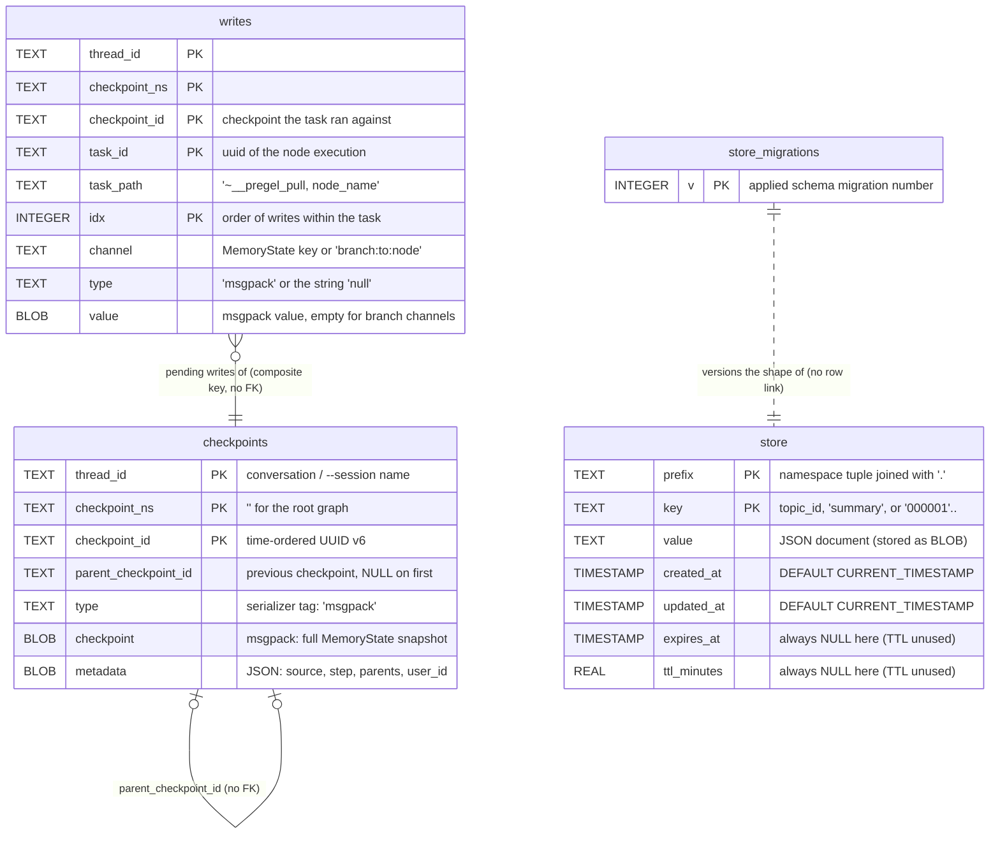
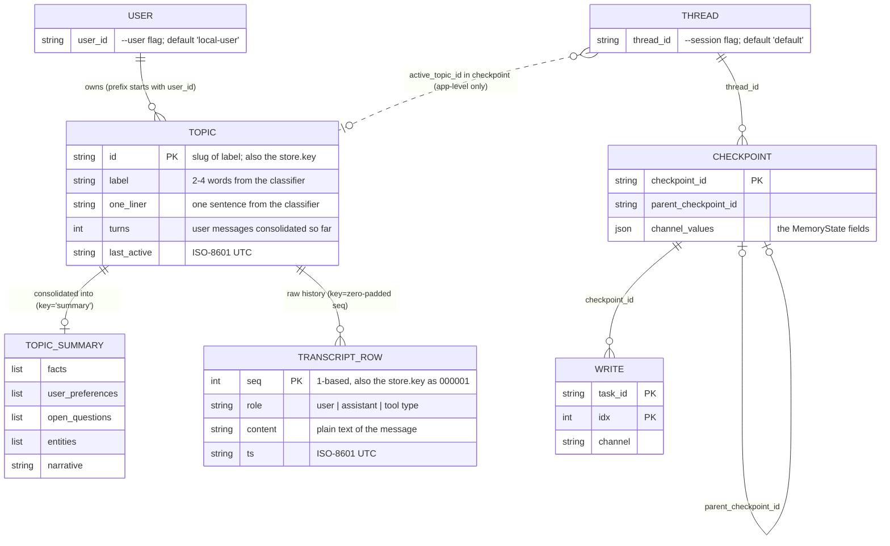

# `memory.db` — entity-relationship reference

`memory.db` is the one SQLite file the harness writes. It is opened by
`open_persistence()` in `src/harness/persistence.py`, which builds two
independent LangGraph persistence objects on top of it:

| Object | Library | Tables | What it is for |
|---|---|---|---|
| `SqliteSaver` (the **checkpointer**) | `langgraph-checkpoint-sqlite` 3.1.3 | `checkpoints`, `writes` | Snapshot of `MemoryState` after every graph step, so a thread (`--session`) can resume |
| `SqliteStore` (the **store**) | `langgraph` 1.2.19 | `store`, `store_migrations` | Long-term, per-user key/value memory: topic registry, topic summaries, raw transcripts |

The two halves never reference each other in SQL. In fact the schema declares
**no foreign keys at all**. Every relationship in this document is either a
composite-key join that the library relies on, a self-referencing chain, or an
application-level convention (a `user_id` string that happens to appear in
both halves). Section 5 spells out which is which.

This document describes the physical tables first, then the logical entities
that the harness encodes *inside* the `store` table, then each field with the
values actually found in the file at the time of writing. For the design
rationale (why a checkpointer *and* a store, why WAL mode, why two
connections) see [architecture.md §7](architecture.md#7-persistence).

All example values below were copied from a real `memory.db` after one
two-turn session: one question about LangSmith vs Langfuse, then one about the
principles of communism. That session produced 12 checkpoints, 23 writes and 5
store rows, all under `thread_id='default'` and `user_id='local-user'`.

---

## 1. Physical ERD — the four tables as SQLite sees them



Indexes that are not visible in the diagram:

| Index | On | Why |
|---|---|---|
| `store_prefix_idx` | `store (prefix)` | `store.search(namespace)` is a prefix scan |
| `idx_store_expires_at` | `store (expires_at) WHERE expires_at IS NOT NULL` | Partial index for TTL sweeps; empty in this database |

> **Try it.** `sqlite3 memory.db .schema` prints exactly the DDL the diagram
> was drawn from. Notice that `expires_at` and `ttl_minutes` sit on the same
> line as `updated_at`: that is the signature of `ALTER TABLE ... ADD COLUMN`,
> i.e. they were added by a later store migration (section 4.4).

---

## 2. Logical ERD — what the harness actually models

The checkpointer tables are generic LangGraph plumbing. The harness-specific
data model lives entirely in `store.value`, as three kinds of JSON document
distinguished by the shape of `store.prefix`. Drawn as entities:



The namespace tree that encodes the left-hand side of that diagram, taken
from the live file (`local-user` is the default `--user`):

```
local-user                                       (user_id)
└── topics                                       prefix = "local-user.topics"
    ├── key = langsmith-vs-langfuse-comparison   → Topic JSON        (registry entry)
    ├── key = principles-of-communism            → Topic JSON        (registry entry)
    ├── langsmith-vs-langfuse-comparison         prefix = "local-user.topics.langsmith-vs-langfuse-comparison"
    │   ├── key = summary                        → TopicSummary JSON
    │   └── transcript                           prefix = "...langsmith-vs-langfuse-comparison.transcript"
    │       ├── key = 000001                     → {seq:1, role:"user", ...}
    │       └── key = 000002                     → {seq:2, role:"assistant", ...}
    └── principles-of-communism                  (no summary, no transcript yet — never consolidated)
```

The helper functions that build these prefixes are `topics_ns`, `topic_ns`
and `transcript_ns` in `src/harness/memory/store.py`. Every read and write
goes through that module, so it is the single place to look when the layout
changes.

---

## 3. Checkpointer tables (`SqliteSaver`)

### 3.1 `checkpoints`

**Purpose.** One row per graph *step* per thread: a complete serialised copy
of `MemoryState` at that instant. LangGraph writes a new row after every node
finishes (and one before the first node runs). The latest row for a
`thread_id` is what `graph.invoke(...)` loads when the CLI is relaunched with
the same `--session`. Older rows are kept, which is what makes "time travel"
possible, but the harness never reads them.

**Written by.** `SqliteSaver.put()`, called by the compiled graph. The harness
never touches this table directly.

| Field | SQL type | Constraints | What it holds | Example from the file |
|---|---|---|---|---|
| `thread_id` | TEXT | PK, NOT NULL | The conversation id. Comes from `config["configurable"]["thread_id"]`, which the CLI sets from `--session`. | `default` |
| `checkpoint_ns` | TEXT | PK, NOT NULL, DEFAULT `''` | Namespace for subgraph checkpoints. The harness has no subgraphs, so it is always the empty string. | `''` |
| `checkpoint_id` | TEXT | PK, NOT NULL | A UUID **v6** (time-ordered; the version nibble is the `6` in `...-6764-...`). Because v6 sorts chronologically, `ORDER BY checkpoint_id` is the step order. | `1f1d7999-2656-6764-bfff-84490eedf9ee` |
| `parent_checkpoint_id` | TEXT | nullable | The `checkpoint_id` of the previous step on this thread. NULL only on the very first checkpoint of a thread. This makes the table a linked list per thread. | `1f1d7999-2656-6764-bfff-84490eedf9ee` (on the second row); `NULL` (on the first) |
| `type` | TEXT | nullable | Serializer tag that `JsonPlusSerializer.loads_typed()` needs to decode `checkpoint`. Always `msgpack` in this file. | `msgpack` |
| `checkpoint` | BLOB | nullable | The msgpack-encoded state snapshot. Grows with the window: 435 bytes before the first node ran, 8 565 bytes once the first assistant reply (with its thinking block) was in state, 2 071 bytes right after the topic switch emptied the window. | 12 rows, 435 – 8 871 bytes |
| `metadata` | BLOB | nullable | **Plain JSON text**, not msgpack. Who produced this checkpoint and at which step, plus every `configurable` key that is a plain string (that is how `user_id` gets here). | `{"source": "input", "step": -1, "parents": {}, "user_id": "local-user"}` |

**Inside the `checkpoint` blob** (decoded with the snippet in section 7):

| Key | Type | What it holds | Example |
|---|---|---|---|
| `v` | int | Checkpoint format version | `4` |
| `ts` | str | ISO-8601 UTC timestamp with microseconds | `2026-11-03T15:18:41.115787+00:00` |
| `id` | str | Same as the row's `checkpoint_id` | `1f1d799d-9ea0-6a18-800a-b93b18f3c180` |
| `channel_values` | dict | **The `MemoryState` fields.** Keys found: `messages` (list of LangChain message objects), `active_topic_id`, `topic_summary`, `unconsolidated_tokens`, `last_decision`. | `active_topic_id='principles-of-communism'`, `topic_summary=''`, `unconsolidated_tokens=958`, `messages=[HumanMessage, AIMessage]` |
| `channel_versions` | dict | A monotonic version string per channel, including internal routing channels. Format is a 32-digit zero-padded step counter, a dot, and a random float. | `messages: 00000000000000000000000000000008.0.7119760516826745` |
| `versions_seen` | dict | Per node, which channel versions it had already consumed. Keys are node names plus `__input__` and `__start__`. | `{'__input__', '__start__', 'classify_topic', 'start_topic', 'agent', 'maybe_consolidate'}` |
| `updated_channels` | list | Channels changed by the step that produced this checkpoint | `['unconsolidated_tokens']` |

**Inside the `metadata` blob:**

| Key | Values seen | Meaning |
|---|---|---|
| `source` | `input`, `loop` | `input` = the checkpoint written when new user input arrived; `loop` = written after a node ran. |
| `step` | `-1`, `0` … `10` | `-1` is the input checkpoint of the first turn; each node execution increments it. Continues across turns on the same thread. |
| `parents` | `{}` | Parent checkpoint per namespace; empty without subgraphs. |
| `user_id` | `local-user` | Copied from `configurable`. This is the only place the checkpointer half of the database mentions the user. |

### 3.2 `writes`

**Purpose.** The *pending writes* of each node execution: which state
channels a node returned, and the value for each. They are stored against the
checkpoint the node ran **from**, and are folded into the **next**
checkpoint's `channel_values`. This is why the checkpoint the `agent`
node ran *from* is tiny (2 071 bytes at step 8) while the next one is large
(6 668 bytes at step 9): the assistant message is in `writes` first, and in
`checkpoints` one step later.
Storing writes separately lets LangGraph resume a half-finished step without
re-running nodes that already completed.

**Written by.** `SqliteSaver.put_writes()`, called by the graph after each node.

| Field | SQL type | Constraints | What it holds | Example from the file |
|---|---|---|---|---|
| `thread_id` | TEXT | PK, NOT NULL | Same as `checkpoints.thread_id` | `default` |
| `checkpoint_ns` | TEXT | PK, NOT NULL, DEFAULT `''` | Same as `checkpoints.checkpoint_ns` | `''` |
| `checkpoint_id` | TEXT | PK, NOT NULL | The checkpoint the task executed against. Together with the two columns above this identifies the parent row in `checkpoints`. | `1f1d7999-4737-6bea-8002-62711bda0d09` |
| `task_id` | TEXT | PK, NOT NULL | UUID of the node execution (one per node run). Several rows share it when a node returns several keys. | `72ef08e5-f18c-d983-24d2-c8a0614a4a90` |
| `task_path` | TEXT | NOT NULL, DEFAULT `''` | Where in the graph the task ran. Always `~__pregel_pull, <node>` here. The node name is the useful part. | `~__pregel_pull, agent` |
| `idx` | INTEGER | PK, NOT NULL | Order of this write within the task, starting at 0. The last write of a node is usually its routing signal. | `0`, `1`, … `4` |
| `channel` | TEXT | NOT NULL | Either a `MemoryState` key, or `branch:to:<node>`, which is how a conditional edge records where control goes next. | `messages`, `last_decision`, `active_topic_id`, `topic_summary`, `unconsolidated_tokens`, `branch:to:classify_topic`, `branch:to:start_topic`, `branch:to:agent`, `branch:to:maybe_consolidate` |
| `type` | TEXT | nullable | Serializer tag for `value`. `msgpack` when the value carries data. For the `branch:to:*` routing rows (8 of 23) it is the **literal string `null`** (the serializer's tag for Python `None`), not SQL NULL, and `value` is a zero-length blob. | `msgpack` / `null` |
| `value` | BLOB | nullable | The msgpack-encoded value the node returned for that channel. | `messages` → `[HumanMessage]`, `[AIMessage]`, `[RemoveMessage, RemoveMessage]`; `active_topic_id` → `'principles-of-communism'`; `unconsolidated_tokens` → `958`; `topic_summary` → `''`; `last_decision` → `{'decision': 'new', 'topic_id': None, 'label': 'Principles of Communism', 'one_liner': '...', 'reasoning': '...'}` |

The channel vocabulary maps one-to-one onto `MemoryState` in
`src/harness/state.py`:

```python
class MemoryState(MessagesState):      # messages: list[BaseMessage]  (inherited)
    active_topic_id: str | None
    topic_summary: str
    unconsolidated_tokens: int
    last_decision: dict | None         # the classifier's TopicDecision
```

---

## 4. Store tables (`SqliteStore`)

### 4.1 `store`

**Purpose.** A key/value tree. Each row is one JSON document addressed by
(`prefix`, `key`). The harness uses it for everything that must outlive a
thread: the topic registry, one structured summary per topic, and the raw
transcript rows per topic. Because the prefix starts with `user_id`, a new
`--session` for the same user sees the same topics.

**Written by.** `SqliteStore.put()` via the helpers in `memory/store.py`:
`upsert_topic` / `new_topic` / `touch_topic` (registry), `put_summary`
(summary), `append_transcript` (transcript). Read via `store.get()` and
`store.search()` from the same module.

| Field | SQL type | Constraints | What it holds | Example from the file |
|---|---|---|---|---|
| `prefix` | TEXT | PK, NOT NULL | The namespace tuple joined with `.`. The harness uses exactly three shapes (next table). | `local-user.topics`, `local-user.topics.langsmith-vs-langfuse-comparison`, `local-user.topics.langsmith-vs-langfuse-comparison.transcript` |
| `key` | TEXT | PK, NOT NULL | The item's name inside its namespace. Topic id for registry rows, the literal `summary` for summaries, a six-digit zero-padded sequence for transcript rows (so lexical order equals chronological order). | `langsmith-vs-langfuse-comparison`, `summary`, `000001` |
| `value` | TEXT (declared) | NOT NULL | The JSON document. **Declared `text` but stored with storage class BLOB** (`typeof(value)` = `blob` on every row) because `SqliteStore` serialises to bytes. The `sqlite3` shell still prints it readably. Three shapes, below. | `{"seq":1,"role":"user","content":"How would you compare LangSmith to Langfuse","ts":"2026-11-03T15:18:23+00:00"}` |
| `created_at` | TIMESTAMP | DEFAULT `CURRENT_TIMESTAMP` | **Time of the most recent put, not the first insert.** `SqliteStore.put()` runs `INSERT OR REPLACE ... CURRENT_TIMESTAMP, CURRENT_TIMESTAMP`, so a rewrite replaces the whole row and resets this column. SQLite format: space separator, no zone, UTC. | `2026-11-03 15:18:23` |
| `updated_at` | TIMESTAMP | DEFAULT `CURRENT_TIMESTAMP` | Time of the most recent put. Always equal to `created_at` for the reason above; the two columns carry the same information in practice. | `2026-11-03 15:18:30` |
| `expires_at` | TIMESTAMP | nullable | TTL expiry, if the store were configured with one. The harness does not use TTLs, so it is NULL on every row. | `NULL` |
| `ttl_minutes` | REAL | nullable | TTL length used to compute `expires_at`. Also NULL on every row. | `NULL` |

**The three `value` shapes.** Which one a row holds is determined by the
number of segments in `prefix` and by `key`:

| Prefix shape | Key | Python type | JSON fields and the values found |
|---|---|---|---|
| `<user>.topics` | `<topic_id>` | `Topic` (TypedDict) | `id` — same slug as the key, e.g. `langsmith-vs-langfuse-comparison`. `label` — classifier's 2–4 word name, `LangSmith vs Langfuse comparison`. `one_liner` — classifier's sentence, `The user wants a comparison of LangSmith and Langfuse, two LLM observability and tracing platforms.` `turns` — count of **user** messages consolidated so far (`1`; the communism topic shows `0` because it has not been consolidated). `last_active` — ISO-8601 UTC, `2026-11-03T15:18:30+00:00`. |
| `<user>.topics.<topic_id>` | `summary` | `TopicSummary` (Pydantic) | `facts` — list of strings (11 for the LangSmith topic, e.g. `LangSmith is made by LangChain Inc. and is closed source; ...`). `user_preferences` — list (`[]` here). `open_questions` — list (`What is the user's stack (frameworks and model SDKs in use)?`, …). `entities` — list of names (`LangSmith`, `Langfuse`, `OpenTelemetry`, `ClickHouse`, …). `narrative` — one paragraph telling the story so far. |
| `<user>.topics.<topic_id>.transcript` | `000001`, `000002`, … | plain `dict` | `seq` — 1-based integer, duplicated in the key. `role` — `user` for `HumanMessage`, `assistant` for `AIMessage`, otherwise the LangChain message `type` (e.g. `tool`). `content` — plain text after `text_of()` flattened any content blocks; rows with empty content are skipped. `ts` — ISO-8601 UTC, `2026-11-03T15:18:23+00:00`. |

Those three Python types are defined in `src/harness/state.py`; the dict for
transcript rows is built inline in `append_transcript`.

### 4.2 Cardinalities, from the live rows

| Topic (registry row) | `turns` | Summary rows | Transcript rows |
|---|---|---|---|
| `langsmith-vs-langfuse-comparison` | 1 | 1 | 2 (seq 1 = user, seq 2 = assistant) |
| `principles-of-communism` | 0 | 0 | 0 |

So: a topic always has a registry row (created by `new_topic` the moment the
classifier says `new`), **0 or 1** summary, and **0 or more** transcript rows.
Summary and transcript appear together on the first consolidation of that
topic (`consolidate()` in `memory/consolidate.py` writes the transcript first,
then the summary, then bumps `turns`). The communism topic was the active
topic when the session ended and was never consolidated, which is exactly the
state that `recall_topic` would need to repair with a `switch-out`
consolidation if the user came back to LangSmith.

### 4.3 Timestamps — two formats in one row

`created_at`/`updated_at` are written by SQLite (`2026-11-03 15:18:23`).
The `ts` and `last_active` fields *inside* `value` are written by Python's
`datetime.isoformat()` (`2026-11-03T15:18:23+00:00`). Both are UTC, but they
do not compare as strings. If you ever need to join or sort across them, use
`replace(created_at, ' ', 'T') || '+00:00'` or parse both in Python.

### 4.4 `store_migrations`

**Purpose.** Bookkeeping for `SqliteStore.setup()`. Each row is the number of
one schema migration that has already been applied, so `setup()` knows which
`ALTER TABLE` / `CREATE INDEX` statements to skip on the next start. It has no
relationship to any data row; it describes the *shape* of the `store` table.

| Field | SQL type | Constraints | What it holds | Example from the file |
|---|---|---|---|---|
| `v` | INTEGER | PK | Migration number, starting at 0. | `0, 1, 2, 3, 4` |

What each applied migration did (from `MIGRATIONS` in
`langgraph/store/sqlite/base.py`):

| `v` | Statement |
|---|---|
| 0 | `CREATE TABLE store (prefix, key, value, created_at, updated_at, PRIMARY KEY (prefix, key))` |
| 1 | `CREATE INDEX store_prefix_idx ON store (prefix)` |
| 2 | `ALTER TABLE store ADD COLUMN expires_at TIMESTAMP` |
| 3 | `ALTER TABLE store ADD COLUMN ttl_minutes REAL` |
| 4 | `CREATE INDEX idx_store_expires_at ON store (expires_at) WHERE expires_at IS NOT NULL` |

If the store were opened with an embedding `index=` config, a fifth table
`store_vectors (prefix, key, field_name, embedding, ...)` would appear. It is
the only table in this library that declares a real foreign key
(`REFERENCES store(prefix, key) ON DELETE CASCADE`). The harness does not
enable it, so it is absent from `memory.db`.

---

## 5. Relationships — what SQL enforces versus what the code relies on

SQLite is **not** enforcing any of these; there is no `REFERENCES` clause
anywhere in the schema. Each relationship exists because a particular piece
of code writes matching values on both sides.

| # | Relationship | Cardinality | Join / link | Enforced by |
|---|---|---|---|---|
| 1 | `writes` → `checkpoints` | many writes : 1 checkpoint | `(thread_id, checkpoint_ns, checkpoint_id)` equal on both tables | `SqliteSaver` writes both; nothing in SQL |
| 2 | `checkpoints` → `checkpoints` | 0..1 parent : 1 child (a chain per thread) | `parent_checkpoint_id` = another row's `checkpoint_id` with the same `thread_id` | `SqliteSaver`; first row has NULL |
| 3 | `store_migrations` → `store` | schema-level only | none at row level | `SqliteStore.setup()` |
| 4 | `checkpoints` ↔ `store` | many threads : 1 user's topic tree | **No SQL link at all.** Two application conventions: `json_extract(metadata,'$.user_id')` equals the first `.`-separated segment of `store.prefix`; and `channel_values.active_topic_id` (inside the msgpack blob) equals a `store.key` under `<user>.topics`. | `run_config()` in `graph.py` puts the same `user_id` into `configurable`; `nodes/topics.py` writes `active_topic_id` from `new_topic()`'s return value |
| 5 | Topic → Summary → Transcript rows (inside `store`) | 1 : 0..1 : 0..N | The `topic_id` is the registry row's `key` **and** the third segment of the child rows' `prefix` | `topics_ns` / `topic_ns` / `transcript_ns` in `memory/store.py` |

Two consequences worth remembering:

- **Deleting is manual.** Removing a topic means deleting its registry row,
  its summary row and all its transcript rows yourself (`DELETE FROM store
  WHERE prefix = 'u.topics.t' OR prefix = 'u.topics.t.transcript' OR (prefix =
  'u.topics' AND key = 't')`). Nothing cascades.
- **The user id is part of the key encoding.** Topic ids are slugified to
  letters, digits and `-` by `new_topic`, so they can never contain a `.`. The
  `--user` flag is not sanitised, so a user id such as `scott.c` would produce
  prefixes that split into one segment too many. Keep user ids free of dots.

---

## 6. Lifecycle — one session as rows

The file was produced by two turns. The table below is the actual
`checkpoints` chain joined to its `writes`, oldest first. Read it top to
bottom and you can see every mechanism in [architecture.md §4](architecture.md#4-sequence-diagrams)
leave a trace in the database.

| step | source | node that ran from this checkpoint | writes recorded against this checkpoint | checkpoint size | what happened in `store` |
|---|---|---|---|---|---|
| -1 | input | `__start__` | `messages` (the HumanMessage), `branch:to:classify_topic` | 435 B | — |
| 0 | loop | `classify_topic` | `last_decision` (`new`, label "LangSmith vs Langfuse comparison"), `branch:to:start_topic` | 728 B | — |
| 1 | loop | `start_topic` | `active_topic_id`, `topic_summary` (`''`), `unconsolidated_tokens` (15), `branch:to:agent` | 1 355 B | `new_topic` → registry row `local-user.topics / langsmith-vs-langfuse-comparison` |
| 2 | loop | `agent` | `messages` (the AIMessage with thinking + text, 6 592 B), `branch:to:maybe_consolidate` | 1 837 B | — |
| 3 | loop | `maybe_consolidate` | `unconsolidated_tokens` (1 450, below the 1 500 threshold → no consolidation) | 8 565 B (now holds the AIMessage) | — |
| 4 | loop | *(none; end of turn)* | — | 8 625 B | — |
| 5 | input | `__start__` | `messages` (second HumanMessage), `branch:to:classify_topic` | 8 808 B | — |
| 6 | loop | `classify_topic` | `last_decision` (`new`, label "Principles of Communism"), `branch:to:start_topic` | 8 871 B | — |
| 7 | loop | `start_topic` | `messages` (**two `RemoveMessage`s**: switch-out consolidation emptied the window), `topic_summary` (`''`), `unconsolidated_tokens` (14), `active_topic_id`, `branch:to:agent` | 8 865 B | `append_transcript` → `000001`, `000002`; `put_summary` → `summary`; `touch_topic` → registry `turns=1`; `new_topic` → registry row `principles-of-communism` |
| 8 | loop | `agent` | `messages` (AIMessage, 4 626 B), `branch:to:maybe_consolidate` | 2 071 B (window is just the new question) | — |
| 9 | loop | `maybe_consolidate` | `unconsolidated_tokens` (958) | 6 668 B | — |
| 10 | loop | *(none; end of turn)* | — | 6 627 B | — |

Things the table makes visible:

- A node's writes land in `writes` against step *N* and appear in
  `checkpoints.checkpoint` at step *N+1*. Compare steps 2 and 3, or 7 and 8.
- The last checkpoint of each turn (steps 4 and 10) has no writes. It is the
  state after `maybe_consolidate`'s update was applied and `END` was reached;
  this is the row that gets loaded when the next turn starts.
- All five `store` rows were written or rewritten during a single node
  execution (step 7). `created_at` on the transcript rows is `15:18:23` and
  on the summary and both registry rows `15:18:30`; the seven-second gap is
  the summariser LLM call that sits between `append_transcript` and
  `put_summary` in `consolidate()`. The LangSmith registry row was first
  inserted at step 1, but `touch_topic` rewrote it at step 7 and that reset
  its `created_at`, which is why it does not read `15:18:2x` or earlier.
- Removed messages are gone from the latest checkpoint (step 8 is 2 071
  bytes) but survive as transcript rows in `store`. That is the whole point of
  writing the transcript *before* emitting `RemoveMessage`.

---

## 7. Queries to try

Run these from the project root after a session. They are all read-only.

```sql
-- The store, laid out as the namespace tree
SELECT prefix, key, length(value) AS bytes, created_at FROM store ORDER BY prefix, key;

-- Checkpoints per thread (how long each session has run)
SELECT thread_id, count(*) AS checkpoints,
       min(json_extract(metadata, '$.step')) AS first_step,
       max(json_extract(metadata, '$.step')) AS last_step
FROM checkpoints GROUP BY thread_id;

-- Relationship 1: each checkpoint with the node that ran and the channels it wrote
SELECT json_extract(c.metadata, '$.step')                  AS step,
       replace(max(w.task_path), '~__pregel_pull, ', '')  AS node,
       group_concat(w.channel, ', ')                      AS channels
FROM checkpoints c
LEFT JOIN writes w
       ON w.thread_id = c.thread_id
      AND w.checkpoint_ns = c.checkpoint_ns
      AND w.checkpoint_id = c.checkpoint_id
GROUP BY c.checkpoint_id
ORDER BY c.checkpoint_id;

-- Relationship 2: walk the parent chain of the newest checkpoint
WITH RECURSIVE chain(checkpoint_id, parent_checkpoint_id, depth) AS (
  SELECT checkpoint_id, parent_checkpoint_id, 0
  FROM (SELECT * FROM checkpoints WHERE thread_id = 'default'
        ORDER BY checkpoint_id DESC LIMIT 1)
  UNION ALL
  SELECT c.checkpoint_id, c.parent_checkpoint_id, chain.depth + 1
  FROM checkpoints c JOIN chain ON c.checkpoint_id = chain.parent_checkpoint_id
)
SELECT depth, checkpoint_id FROM chain;

-- Relationship 5: every topic with its summary and transcript counts
SELECT t.key                                                     AS topic_id,
       json_extract(t.value, '$.turns')                          AS turns,
       (SELECT count(*) FROM store s
         WHERE s.prefix = t.prefix || '.' || t.key AND s.key = 'summary') AS summaries,
       (SELECT count(*) FROM store x
         WHERE x.prefix = t.prefix || '.' || t.key || '.transcript')      AS transcript_rows
FROM store t
WHERE t.prefix = 'local-user.topics';

-- Relationship 4: the user that links the two halves (no join possible, just compare)
SELECT DISTINCT json_extract(metadata, '$.user_id') AS user_in_checkpoints FROM checkpoints;
SELECT DISTINCT substr(prefix, 1, instr(prefix, '.') - 1) AS user_in_store FROM store;
```

The msgpack blobs are opaque to SQL. Decode them with the same serializer
LangGraph used to write them:

```python
# .venv/bin/python
import sqlite3
from langgraph.checkpoint.serde.jsonplus import JsonPlusSerializer

serde = JsonPlusSerializer()
db = sqlite3.connect("file:memory.db?mode=ro", uri=True)

typ, blob = db.execute(
    "SELECT type, checkpoint FROM checkpoints ORDER BY checkpoint_id DESC LIMIT 1"
).fetchone()
cp = serde.loads_typed((typ, blob))
print(cp["id"], cp["ts"])
print(cp["channel_values"]["active_topic_id"], cp["channel_values"]["unconsolidated_tokens"])
for m in cp["channel_values"]["messages"]:
    print(type(m).__name__, str(m.content)[:60])

for channel, typ, val in db.execute(
    "SELECT channel, type, value FROM writes ORDER BY checkpoint_id, idx"
):
    # branch:to:* rows have type='null' and decode to None
    print(channel, repr(serde.loads_typed((typ, val)))[:80])
```

---

## 8. Gotchas

- **`store.search()` matches the prefix, not the exact namespace.** Searching
  `("local-user", "topics")` also returns every summary and transcript row
  beneath it. `_search_exact` in `memory/store.py` filters to the exact
  namespace; use the same trick in ad-hoc SQL (`prefix = ?`, not `prefix LIKE
  ? || '%'`) unless you really want the subtree.
- **`metadata` is JSON, `checkpoint` is msgpack.** `json_extract` works on
  the former and silently returns NULL on the latter.
- **`writes.type` is never SQL NULL.** Routing rows carry the string `'null'`,
  so `WHERE type IS NOT NULL` does not exclude them; use `type <> 'null'`.
- **`value` columns are BLOBs even when the DDL says `text`.** Cast with
  `cast(value AS text)` if a tool refuses to display them.
- **Two timestamp formats** (section 4.3).
- **`store.created_at` is not the creation time.** Every put is an
  `INSERT OR REPLACE`, so `created_at` moves on each rewrite. To date a
  topic's origin use the `ts` of its `000001` transcript row, or
  `last_active` in the registry row for its most recent activity.
- **`expires_at` / `ttl_minutes` exist but are unused.** Do not mistake the
  partial index for evidence that rows expire.
- **User ids must not contain `.`** (section 5).
- **Nothing cascades.** Deleting a thread means deleting its rows in both
  `checkpoints` and `writes`; deleting a topic means three prefixes in `store`.
- **The latest checkpoint is not the history.** Once `RemoveMessage` has been
  applied, only `store` transcript rows (and older checkpoints) still hold
  those messages. The `recall_detail` tool searches the transcript rows for
  exactly this reason.
